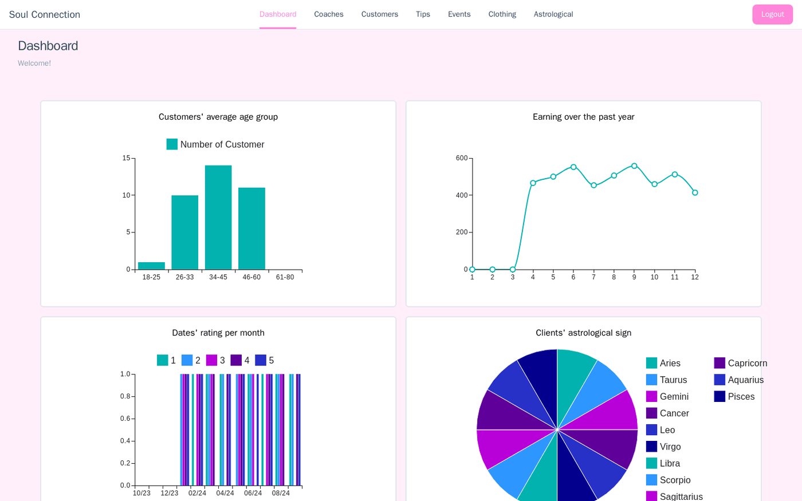
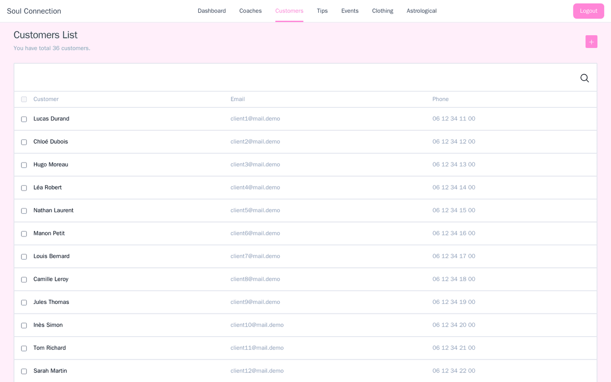
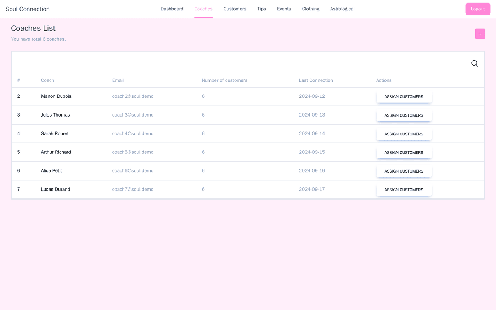

<div align="center">

# Soul Connection

**Le CRM d'une agence de coaching amoureux, conçu et livré en deux semaines.**

      

<sub>Projet à 4 · 2024</sub>

</div>

<br/>

<p align="center"></p>

## Le projet en quelques mots

Un rush de deux semaines à quatre pour une agence fictive, *Soul Connection*. On partait d'une API fournie, et il fallait livrer un vrai outil interne : tableau de bord, fiches clients, gestion des coachs, événements… avec un brin d'astrologie pour la compatibilité.

## Ce que ça fait

- **Tableau de bord** : tranches d'âge, revenus de l'année, notes des rendez-vous, signes astrologiques
- **Clients** : liste, recherche, fiche détaillée, création et modification
- **Coachs** : liste, nombre de clients, attribution de clients, création de compte
- **Compatibilité astrologique** entre deux clients
- Événements sur une carte, conseils pour les coachs, garde-robe des clients
- Rôles manager / coach, session sécurisée par JWT et cookies chiffrés

<p align="center"></p>
<p align="center"><sub>La liste des clients</sub></p>

<p align="center"></p>
<p align="center"><sub>Les coachs et l'attribution des clients</sub></p>

## Lancer le projet

```bash
pnpm install
# .env.local : MONGODB_URI, SECRET_KEY, clés S3 et Google Maps
pnpm build && pnpm start
```

> Les captures ont été prises en local avec des données fictives.

## L'équipe

<a href="https://github.com/Wilson-Epitech/survivor/graphs/contributors"></a>

Wilson Bordichon, Mathis Brehm, Yanis Harkouk, Eva Legrand

**Ma partition :** J'ai fait la **navigation** de l'app, les **formulaires** de création et d'édition des clients et des employés, les pages **Clients**, **Coachs** et **Compatibilité astrologique**, et plusieurs composants réutilisables.
